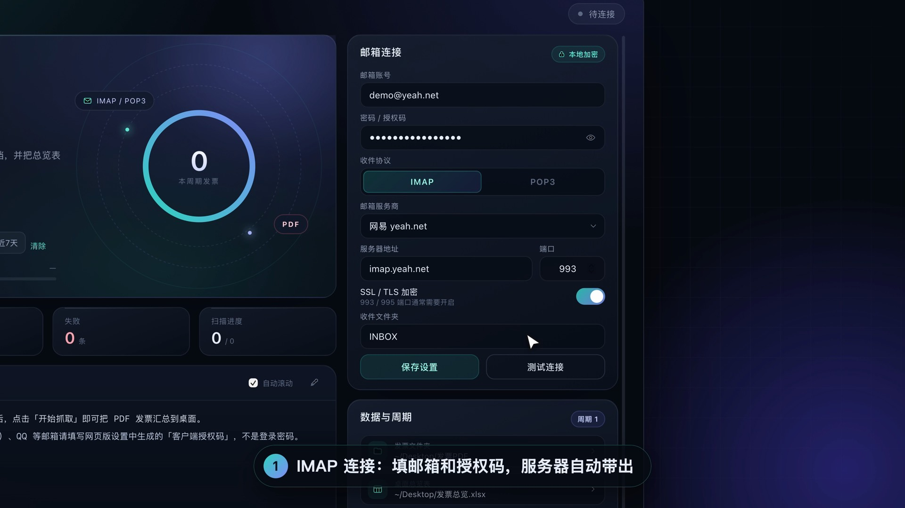
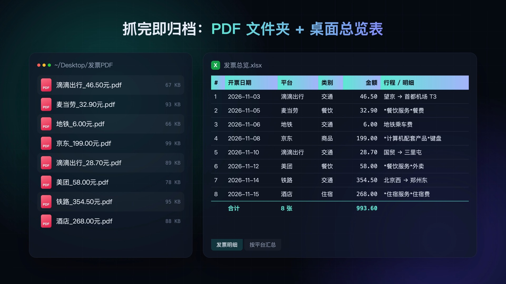

# 发票捕手 Invoice Catcher

一款为 macOS 与 Windows 打造的小工具：连接你的邮箱，自动抓取里面的 PDF 电子发票，去重归档，并在桌面维护一张随时可查的《发票总览》表。


第一次使用请先阅读 **[使用说明](docs/使用说明.md)**：里面有各邮箱开启 IMAP/POP3、获取授权码的完整步骤，以及常见连接报错的排查方法。

| 抓取与配置界面 | 归档结果 |
| --- | --- |
|  |  |

## 功能

- **一键抓取**：点击「开始抓取」，按钮立即变为「停止抓取」，随时可以中断。
- **IMAP / POP3 双协议**：内置网易 yeah.net / 188、QQ、163、126、新浪、Gmail、Outlook、iCloud、阿里企业邮等常用服务器预设，也可手动填写。
- **实时控制台**：每张发票的抓取结果、重复跳过、失败原因都会逐条打印在软件内。
- **桌面总览表**：每次抓到新发票都会自动更新桌面上的 `发票总览.xlsx`。第一页「发票明细」包含序号、开票日期、平台、类别、金额、发票号码、销方名称、行程、明细、文件名；第二页「按平台汇总」按平台统计张数和金额，均带合计行和筛选。
- **智能去重**：按邮件 UID + 附件内容哈希双重去重，重复扫描不会重复入账。
- **从点击当天开始**：每个周期第一次点「开始抓取」时，会把当天固定为起始日；之后无论隔多久再抓，都只抓该日期及以后的邮件，不会翻出历史发票。
- **链接型发票**：部分平台（如诺诺发票的地铁/出租车票）邮件里没有 PDF 附件，程序会自动打开邮件内的发票链接并点击「下载PDF文件」完成归档，同一页面的 XML 用于补全号码、金额、销方。已适配 nuonuo.com、jss.com.cn、baiwang.com、piaozone.com。
- **按日期区间补抓**：「打开总览表」下方可填起始/结束日期（或用「近7天」快捷按钮），再次抓取就按该区间回溯；不填日期则沿用本周期起始日规则。IMAP 最长 366 天、POP3 最长 90 天，超出会自动收敛。手动区间只扫描该日期段，不改动本周期起始日，也不推进增量位点。
- **只保留 30 天**：按「抓取时间」计算，发票记录与 PDF 保留 30 天，超期数据在启动、每次抓取结束以及每 6 小时自动清理，总览表同步更新。补抓的历史发票同样从抓取当天起算 30 天。
- **周期管理**：点击「开启新周期」会清空已抓发票与总览表、重置去重记录与起始日，邮箱配置保留，适合按月/按项目归档。
- **本地优先**：账号、授权码保存在系统安全存储中（macOS Keychain / Windows DPAPI），发票只留在你的电脑上，不上传任何服务器。

## 快速开始

### 下载现成安装包

到 **[Releases](https://github.com/yu024/invoice-catcher/releases/latest)** 下载对应版本，无需自己编译：

| 系统 | 文件 | 说明 |
| --- | --- | --- |
| macOS（Apple 芯片） | `发票捕手-1.0.0-macOS-arm64.zip` | 解压后把 `发票捕手.app` 拖进「应用程序」 |
| macOS（Intel） | `发票捕手-1.0.0-macOS-x64.zip` | 同上 |
| Windows 10/11 x64 | `invoice-catcher-1.0.0-win-x64-portable.zip` | 解压后双击 `发票捕手.exe`，免安装 |

两个平台都未做代码签名：macOS 首次打开请右键 App →「打开」→ 再点「打开」（或执行 `xattr -cr "/Applications/发票捕手.app"`）；Windows 遇到 SmartScreen 提示点「更多信息 → 仍要运行」。

打开后在右侧填写邮箱地址和**授权码**（不是网页登录密码，获取方法见 [使用说明](docs/使用说明.md)），点「测试连接」，成功后点「开始抓取」。抓到的 PDF 统一保存到桌面 `发票PDF` 文件夹，总览表也生成在桌面。

> 如果 Releases 里暂时没有你需要的版本，可以用下面的方式自行构建，或直接在 [Actions](https://github.com/yu024/invoice-catcher/actions) 里下载 CI 构建产物。

### 从源码运行

需要 Node.js 18+ 与 pnpm：

```bash
pnpm install
pnpm start        # 普通启动
pnpm dev          # 启动并打开 DevTools
```

### 打包

先执行一次 `pnpm install`，然后：

```bash
pnpm run package              # macOS：.app + zip，产物在 dist/
pnpm run package:win-portable # Windows x64 免安装版，产物在 dist-win-out/
pnpm run package:win          # Windows：NSIS 安装包，产物在 dist-win/（需在 Windows 上运行）
```

`package` 默认按当前机器架构打包，可用 `ARCH=x64 pnpm run package` 指定 Intel 版。

`package:win-portable` 在 macOS / Linux / Windows 上都能直接跑（electron-packager 交叉打包，不需要 Wine），推 tag 时 GitHub Actions 会自动为两个平台各构建一份并挂到 Release，见 [.github/workflows/build.yml](.github/workflows/build.yml)。

## 数据与文件位置

| 内容 | 位置 |
| --- | --- |
| 发票 PDF | `~/Desktop/发票PDF`（可在界面中更改） |
| 发票总览表 | `~/Desktop/发票总览.xlsx` |
| 邮箱配置 | `~/Library/Application Support/发票捕手/config.json` |
| 授权码 | `~/Library/Application Support/发票捕手/secret.bin`（系统安全存储加密：macOS Keychain / Windows DPAPI） |
| 周期与去重记录 | `~/Library/Application Support/发票捕手/cycle.json`（含本周期起始日 `fetchFrom`） |

> Windows 下配置目录为 `%APPDATA%\发票捕手`，发票 PDF 与总览表同样落在桌面。

## 常见邮箱设置

| 邮箱 | IMAP | POP3 | 备注 |
| --- | --- | --- | --- |
| 网易 yeah.net | imap.yeah.net:993 | pop.yeah.net:995 | 网页版「设置 → POP3/SMTP/IMAP」开启服务并生成客户端授权码 |
| 网易 188 | imap.188.com:993 | pop.188.com:995 | 同上 |
| QQ | imap.qq.com:993 | pop.qq.com:995 | 设置 → 账户 → 开启 IMAP/SMTP，生成授权码 |
| 163 | imap.163.com:993 | pop.163.com:995 | 需在网页版开启 IMAP/SMTP 服务并使用授权码 |
| 126 | imap.126.com:993 | pop.126.com:995 | 同上 |
| 新浪 | imap.sina.com:993 | pop.sina.com:995 | 网页版设置中开启 IMAP 并生成授权码 |
| Gmail | imap.gmail.com:993 | pop.gmail.com:995 | 需开启两步验证并使用「应用专用密码」 |
| Outlook | outlook.office365.com:993 | outlook.office365.com:995 | 多数账号已停用密码登录，需 OAuth2（暂不支持） |
| iCloud | imap.mail.me.com:993 | pop.mail.me.com:995 | 使用 App 专用密码 |
| 阿里企业邮 | imap.qiye.aliyun.com:993 | pop.qiye.aliyun.com:995 | 使用客户端专用密码 |

> 大多数邮箱不允许直接使用网页登录密码，请务必填写「授权码 / 应用专用密码」，否则会提示登录失败。

## 发票识别说明

程序会解析 PDF 文本，尝试提取：

- **发票号码**：`发票号码`、`数电票号码`、`票据号码`
- **开票日期**：`开票日期` / `开具日期`
- **价税合计**：优先取「价税合计（小写）」，否则从大写金额换算
- **销方名称**：发票中「销售方」区域的名称
- **平台 / 类别**：根据发票内容、附件名和邮件信息推断（滴滴出行、享道出行、地铁、铁路、京东、美团等，以及交通/商品/餐饮/住宿/服务/其他）
- **行程 / 明细**：从备注行程和「*项目*名称」中提取，识别不到时行程显示「未提供」

不同地区、不同开票平台的版式差异较大，识别不到的字段会留空，但 PDF 仍会被完整保存和汇总，不影响归档。

## 技术结构

```
src/
  main/         Electron 主进程
    index.js    窗口、IPC、生命周期
    fetcher.js  IMAP/POP3 抓取流水线、去重、归档
    pop3.js     轻量 POP3 客户端
    invoice.js  PDF 发票信息提取、附件类型判断
    invoice-link.js  链接型发票下载（诺诺 / 百望 / 票纵横等）
    excel.js    总览表生成（ExcelJS）
    store.js    配置 / 周期 / 去重存储
    util.js     通用工具
  preload.js    contextBridge 安全桥
  renderer/     界面（原生 HTML/CSS/JS）
scripts/
  package-mac.sh           macOS 打包脚本
  package-win-portable.sh  Windows x64 免安装版打包脚本（任何平台都能跑）
  package-win.sh           Windows NSIS 安装包构建脚本（需 Windows）
build/
  make-icon.py    图标生成脚本
```

抓取流程：连接邮箱 → 按 UID 增量扫描 → 筛选含 PDF 附件或发票链接的邮件 → 剔除行程单 → SHA-256 去重 → 解析发票字段 → 归档 PDF → 写入总览表。

`promo/` 下是演示视频的工程文件（HTML 时间线 + WKWebView 逐帧渲染），想改画面或重新出片见 [promo/README.md](promo/README.md)。

## 已知限制

- 支持 PDF 附件与 4 个平台的链接型发票；图片格式发票（JPG/PNG）暂不处理。
- POP3 只能收件箱、按 UIDL 增量，且部分服务商限流；邮件量大时建议用 IMAP。
- 第一次抓取从「点击当天」开始，不回溯历史；需要补抓某段历史请用日期区间（IMAP ≤ 366 天，POP3 ≤ 90 天）。
- Outlook / Microsoft 365 已大面积停用密码类基础认证，本工具暂不支持 OAuth2 登录，可能无法连接。
- 总览表被 Excel 打开时写入会自动重试，若持续失败请先关闭表格再重试。

## Windows 版

同一套代码可以构建两种 Windows 10/11 x64 包：

```bash
pnpm run package:win-portable   # 免安装版：dist-win-out/invoice-catcher-1.0.0-win-x64-portable.zip
pnpm run package:win            # NSIS 安装包：dist-win/invoice-catcher-setup-<版本>.exe（需 Windows）
```

- Release 里挂的是免安装版：解压到任意目录，双击 `发票捕手.exe` 即可，卸载直接删文件夹。
- 两个包都未做代码签名，首次运行 SmartScreen 会提示「未知发布者」，点「更多信息 → 仍要运行」即可。
- 数据保存在 `%APPDATA%\发票捕手`，发票 PDF 与《发票总览.xlsx》同样落在桌面。
- Windows 下使用自绘标题栏（窗口右上角为系统原生的最小化/最大化/关闭按钮），字体自动回退到「微软雅黑」。

## 许可证

[MIT](LICENSE)
